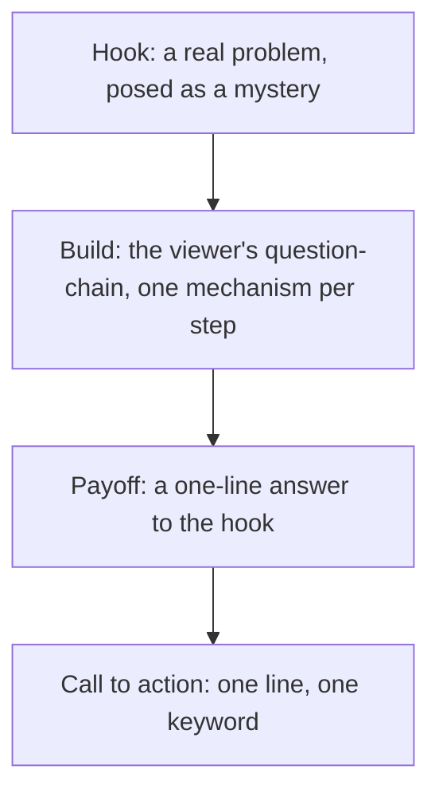

# content-system

*A Claude skill that turns a technical topic into a short-form video script which stays engaging as a story and accurate as an explanation.*

**Hand it a source and the idea you want to explain. It returns a reel, Shorts, or TikTok script that opens on a real problem, explains the real mechanism in plain words, and pays off at the end.**


Most explainer scripts fail one of two ways. Some are correct but dull, and some are fun but say nothing true. This skill holds both at once, in the voice of a person talking to a friend.

Install it in Claude Code by cloning this folder into your skills directory:

```bash
git clone https://github.com/rishabhrawat35/content-system.git ~/.claude/skills/content-system
```

## What it produces

A script built from three beats, in a flat and natural voice, with the technical substance kept intact:

| Beat | What it does |
|---|---|
| Hook | Opens on a specific, real problem and stops at the strange result, so the viewer wants the answer. |
| Build | Explains the mechanism as the chain of questions the viewer is already asking, one idea per step. |
| Payoff | Answers the opening question in about a line, then stops, with a single call to action. |

The method, the voice rules, and a full worked example are in [SKILL.md](SKILL.md).

## How it works



Two rules do most of the work. The voice rule keeps the writing flat and cuts the patterns that read as AI, so a sentence earns its place only by moving the story or adding substance. The substance rule keeps every fact that is a link in the explanation and cuts facts that lead nowhere, so the tech stays real without turning into trivia.

## Install

### Claude Code

Clone into `~/.claude/skills/content-system` (shown above). The skill loads on the next session. Invoke it with `/content-system`, or ask for a script on a technical topic and it applies on its own.

### claude.ai

Package the folder as a zip and upload it under Settings, then Capabilities, then Skills:

```bash
cd ~/.claude/skills && zip -r content-system.zip content-system -x '*.git*'
```

Upload `content-system.zip`.

## Quickstart

1. Give the skill a source and the hero of the piece. For example: "make a reel on how chain-of-thought prompting works, using the coin-probability example."
2. Read the draft against the checklist at the end of [SKILL.md](SKILL.md): hook as a mystery, question-chain build, payoff that stops, no slop.
3. Ask for one change at a time (shorter, simpler, a different protagonist). The skill keeps the tech accurate while it adjusts the story.

## Limits and non-goals

- It writes the script. It does not record audio, edit video, or generate captions.
- It covers one idea per script. A second idea is a second script.
- It needs a source you provide. It does not research the topic for you.

## Status

Working as of October 2026. The method is stable, and the same three beats apply to any technical subject, not only the AI topic in the worked example.

## License

No license yet.
